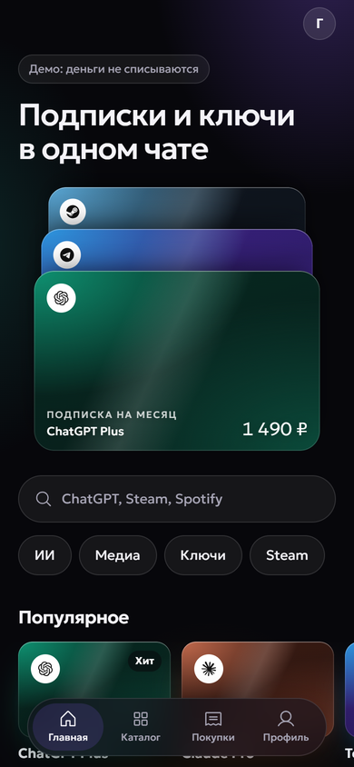

# Nebula — магазин цифровых товаров в Telegram


Витрина ИИ-подписок, игровых ключей и медиа, которая живёт внутри Telegram. Каждый товар
выглядит стеклянной картой с цветом бренда и номиналом; каталог, экран товара, пополнение
Steam и список покупок работают без перехода в браузер. В Telegram оплата настоящая — звёздами в чате с ботом (Cloudflare Workers, [worker/](worker/)):
цену бот берёт из того же каталога, что и витрина, выставляет счёт в XTR, перед списанием
проверяет, что заказ ещё не оплачен, пишет его в D1 и уведомляет продавца. Магазин
демонстрационный, поэтому счёт — на 1 ⭐, и звезда сразу возвращается. В обычном браузере
покупка имитируется. Заказы — командой `/orders`.

**Живое демо → https://automatorr192-dev.github.io/nebula-shop/** (открывается и в обычном браузере),
в Telegram — [@autodigitalstorrebot](https://t.me/autodigitalstorrebot)



## Как работает

```
/start → бот отдаёт кнопку WebApp → мини-апп открывается в Telegram
       → каталог, карта товара, MainButton «Купить · сумма» → «Покупки»
```

Сейчас мини-апп раздаёт GitHub Pages, бот запускается отдельно. Целевая схема — один
контейнер на оба: FastAPI отдаёт статику мини-аппа, бот-лаунчер живёт фоновой задачей в его
`lifespan`. Так сделано потому, что на Amvera тарифицируется каждое приложение отдельно, и
разносить витрину с ботом по двум сервисам — платить дважды. Код готов, переезд = сменить
`WEBAPP_URL` и выключить workflow Pages.

Что здесь неочевидного:

- **Кэш мини-аппа не сбрасывается.** WebView Telegram держит старую сборку, а API инвалидации
  у Telegram нет. Поэтому адрес мини-аппа несёт метку версии (`?v=`), а статика отдаётся с
  `Cache-Control: no-cache` — браузер сверяет ETag и забирает свежее.
- **Наружу смонтирована только `webapp/`**, не корень: рядом лежат `bot.py` и `.env`.
- **Мини-апп собирается из `web/`** (Vite + React) прямо в `webapp/`. В git сборки нет: её делают CI перед тестами, workflow Pages и первая стадия Dockerfile.

## Стек

Vite · React 19 · TypeScript · Python 3.11 · aiogram 3 · FastAPI · Docker · GitHub Actions · Amvera

## Запуск

```bash
cp .env.example .env    # BOT_TOKEN и WEBAPP_URL
docker compose up --build
```

Мини-апп отдельно (горячая перезагрузка):

```bash
cd web && npm ci
npm run dev        # http://localhost:5173
npm run build      # сборка в ../webapp
```

Без Docker:

```bash
python -m venv .venv && .venv\Scripts\activate
pip install -r requirements.txt -r requirements-dev.txt
uvicorn main:app --reload
```

Мини-апп открывается и просто в браузере — в этом случае методы Telegram подменяются
заглушками, чтобы верстку можно было отлаживать без телефона.

## Тесты

```bash
ruff check . && pytest -q
```
